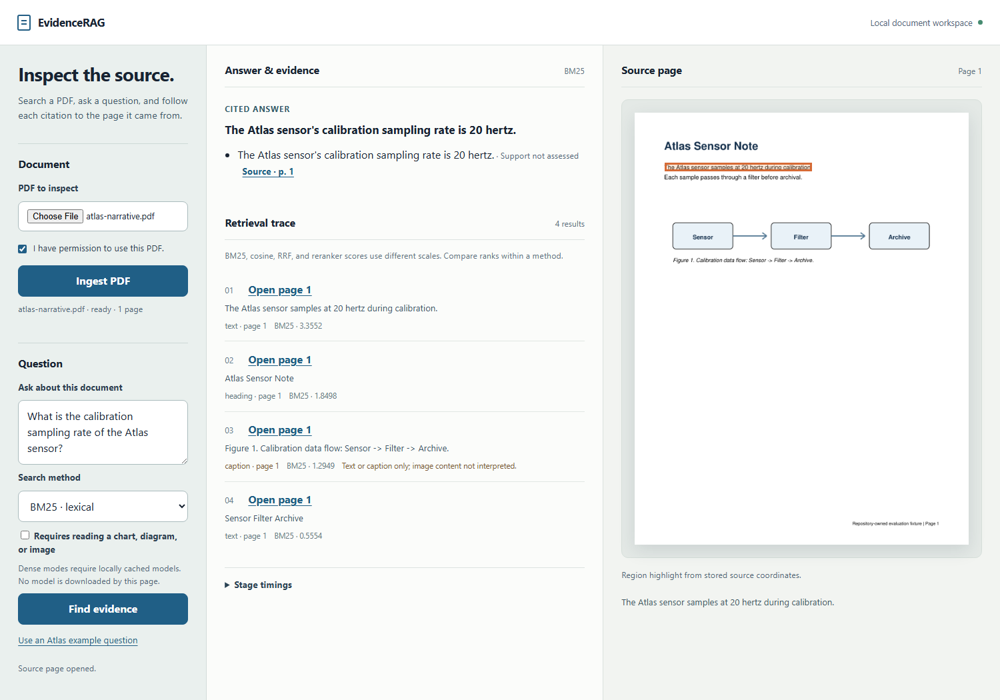
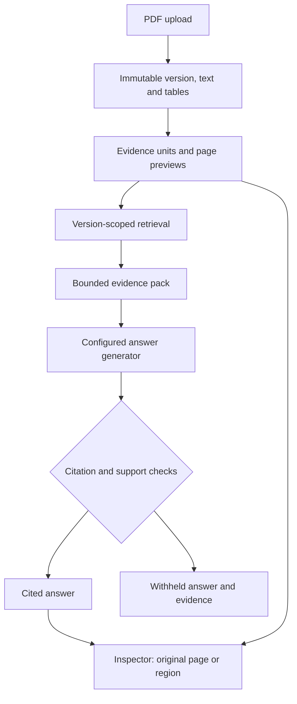

# EvidenceRAG

**Answers you can trace back to the PDF.**

[Download v0.2.0](https://github.com/ompatelz/EvidenceRAG/releases/tag/v0.2.0) ·
[Install and connect an agent](docs/agent_integration.md) ·
[Current status](docs/PROJECT_STATUS.md)

[](https://github.com/ompatelz/EvidenceRAG/actions/workflows/ci.yml)
[](pyproject.toml)
[](LICENSE)

EvidenceRAG is a local PDF retrieval and grounded-answer prototype. Upload a technical
document, compare retrieval methods, and open a citation directly on its original
page or highlighted region. Answers pass through citation and support checks;
the system can withhold a draft when the evidence is insufficient or conflicting.

[Try the demo](#quickstart) · [Architecture](#how-it-works) · [Results](#evaluation) · [Live providers](docs/live_answers.md) · [Technical walkthrough](docs/interview.md)



*The screenshot shows the opt-in, fixed Atlas fixture answer. Live provider
answers are configured separately.*

## Use it in your own agent

Use the Python package directly, call the JSON CLI, connect the optional stdio
MCP server, or export the bundled companion skill. All share the same retrieval
and evidence checks. Your agent supplies its own model and drafts.

| Interface | Entry point |
| --- | --- |
| Python SDK | `from evidence_rag.sdk import EvidenceRAG, DocumentRef, SearchRequest` |
| CLI | `evidence-rag ingest`, `documents`, `status`, `page`, `search`, `evidence`, `check`, `retry` |
| MCP server | `evidence-rag mcp` with separately installed transport requirements |
| Agent skill | `evidence-rag export-skill ./evidence-rag-agent` |
| Web inspector | Existing FastAPI `/inspector` application |

[Package installation and agent setup](docs/agent_integration.md) ·
[Agent evaluation protocol](docs/agent_evaluation.md)

## What you can do

| Capability | Implementation |
| --- | --- |
| Inspect original evidence | PDF page previews, region highlights, and page-level fallback when a precise region is unavailable |
| Compare retrieval methods | BM25, dense embeddings, hybrid reciprocal rank fusion, and optional CPU cross-encoder reranking |
| Trace document versions | Immutable SHA-256 versions with version-scoped evidence, citations, and previews |
| Check generated answers | Bounded evidence packs, citation resolution, table checks, optional semantic verification, and abstention |
| Choose a live provider | Signed-in Codex CLI, OpenRouter, or OpenAI API, with explicit consent per query |
| Reproduce experiments | Owned PDF fixtures, reviewed labels, saved rankings, raw outcomes, and evaluation protocols |

**Stack:** Python · FastAPI · Pydantic · PyMuPDF · FastEmbed · Qdrant · vanilla JavaScript · Docker · GitHub Actions

## Quickstart

Use Python 3.12 and uv 0.12.7 for the documented setup.
BM25 and the fixed demo need no API key or model download.

```sh
git clone https://github.com/ompatelz/EvidenceRAG.git
cd EvidenceRAG
uv sync --locked --all-extras --dev
```

Start the local demo in **PowerShell**:

```powershell
$env:EVIDENCERAG_DEMO_ANSWERS = 'true'
uv run --locked uvicorn evidence_rag.api:create_app --factory --host 127.0.0.1 --no-access-log
```

Or in **Bash**:

```sh
EVIDENCERAG_DEMO_ANSWERS=true uv run --locked uvicorn evidence_rag.api:create_app --factory --host 127.0.0.1 --no-access-log
```

1. Open [the inspector](http://127.0.0.1:8000/inspector).
2. Upload `datasets/fixtures/atlas-narrative.pdf` and confirm permission.
3. Select **Use an Atlas example question**, then run BM25.
4. Open the answer citation to inspect the source highlight.
5. Ask “What is the calibration sampling rate on Neptune?” to see abstention.

The demo emits one fixed answer for the owned Atlas fixture. With demo mode
disabled and no live generator configured, retrieval works and the API reports
`generator_unavailable`. Dense, hybrid, reranking, and semantic verification
require their pinned model weights to be cached locally.

[Three-minute demo](docs/demo.md) · [Inspector guide](docs/inspector.md) ·
[Dense model setup](docs/dense_baseline.md) · [Container and rollback](docs/release.md)

### Enable live answers

Configure **one** provider for the local server: Codex CLI, OpenRouter, or
OpenAI API. Each question requires provider-specific consent before the selected
question, PDF text excerpts, and citation identifiers leave the local process.
The draft still passes through independent local grounding checks.

Follow the [provider setup and smoke instructions](docs/live_answers.md),
including the pinned [verifier setup](docs/semantic_support.md).
Codex and OpenRouter have recorded owned-fixture smokes; the separately billed
OpenAI API smoke remains pending. [Provider smoke evidence](reports/live-provider-smoke.md)

## How it works



Ingestion publishes a ready document only after extraction and preview rendering
complete. Retrieval stays scoped to that exact version. Generated claims must
cite evidence supplied in the pack, and citations must resolve to source assets.
The inspector distinguishes precise region anchors from page-only references.
BM25, cosine, RRF, and reranker scores retain their own scales.

[Architecture decisions](docs/architecture.md) · [Answer contract](docs/answer_contract.md) ·
[Abstention policy](docs/abstention.md) · [Reliability and privacy](docs/reliability.md)

## Evaluation

### Reviewed retrieval comparison

The owner reviewed 36 questions across seven synthetic PDF families.
The current report scores 24 answerable, nonvisual development and validation
questions; the comparison below uses the same **11 validation questions**.

| Retrieval method | Validation nDCG@5 |
| --- | ---: |
| BM25 | 0.797 |
| Dense | 0.842 |
| Hybrid RRF | 0.808 |
| Hybrid + reranker | 0.842 |

Hybrid fusion did not beat dense retrieval on this set. Reranking matched dense
nDCG@5. These small synthetic results do not establish performance on arbitrary PDFs.

[Run record and raw outputs](reports/reviewed-answer-benchmark/README.md) ·
[Current baseline](reports/reviewed-answer-benchmark/baselines.md) ·
[Retrieval ablation](reports/reviewed-answer-benchmark/retrieval-ablation.md)

### Separate held-out answer run

A single Codex run used BM25 and the pinned local verifier on two new owned PDF
families, with all six labels approved before inference.

| Measure | Observed result |
| --- | ---: |
| Answerable questions with gold evidence retrieved at K=5 | 4/4 |
| Gold evidence units found | 5/5 |
| Correct final answers / answerable questions | 2/4 |
| Answerable coverage | 2/4 |
| False answers / unanswerable questions | 0/2 |
| Supported emitted claim–citation links | 2/2 |

The verifier withheld two answerable drafts, including a cross-page deadline.
Label approval was by the owner; emitted-claim source checks were by the agent.
There were no visual-dependent questions, and this test remains closed to tuning.
An [exploratory three-arm agent trial](reports/agent-comparison/README.md)
found no quality gain and one additional false abstention in the skill arm.
Broader live-answer comparisons and owner claim judgments remain research work.

[Held-out report, freeze, and raw outcomes](reports/reserved-final-evaluation.md)

### Historical diagnostics

The earlier fixed-draft support experiment reduced false answers on four
unanswerable cases from **3/4 to 0/4**, while coverage fell from **12/13 to 6/13**
and correct answers from **7/13 to 6/13**. It used provisional labels and fixed
drafts, not live generation. [Paired study](reports/ablation_study.md)

An operational smoke observed **173.21 ms/page ingestion** and **12.24 ms for one
cited BM25 query** on a one-page owned fixture, Windows i7-13700H, sequential
in-process ASGI. These are individual smoke observations.
[Raw smoke](reports/runs/local-release-smoke.json) · [Measurement conditions](docs/reliability.md)

The older retrieval-only [frozen diagnostic](reports/final_evaluation.md) is
preserved separately. [Evaluation protocol](docs/evaluation_protocol.md) ·
[Claims audit](docs/claims.md)

## Development

After the locked setup above, install Node.js and run the shared quality gate:

```sh
uv run --locked python scripts/quality_gate.py
```

The gate checks the lockfile, Ruff lint and formatting, strict mypy, Python
tests, inspector JavaScript behavior, deterministic PDF fixtures, evaluation
data, and report smokes. Required CI uses deterministic provider responses.
Live Qdrant integration runs in a separate CI job.

| Location | Contents |
| --- | --- |
| [src/evidence_rag](src/evidence_rag) | API, ingestion, evidence contracts, retrieval, answers, and evaluation |
| [tests](tests) | Runtime, contract, integration, and inspector checks |
| [datasets](datasets) | Owned fixtures, manifests, review packets, and evaluation labels |
| [configs](configs) | Reproducible retrieval experiment settings |
| [reports](reports) | Analyses, rankings, raw runs, and provenance |
| [docs](docs) | Design decisions, setup, operations, and project status |
| [scripts](scripts) | Quality gate, fixture generation, and smoke tools |

## Scope and limits

This is a **local, single-user, single-process prototype**. Keep it on loopback.
PDFs and derived assets stay in local storage; external generation is off by
default. The caller is responsible for permission to use uploaded documents.

OCR, pixel-level chart or diagram interpretation, multi-page table linking,
shared-host access control, and durable distributed ingestion are outside the
current scope. A source highlight identifies an evidence location; retrieval
and support decisions can still be wrong, and supported answers can be withheld.

[Current project status](docs/PROJECT_STATUS.md) ·
[Error analysis](reports/error_analysis.md) ·
[Source review guide](datasets/eval/SOURCE_REVIEW_GUIDE.md)

## License

Application code is licensed under [GNU AGPLv3](LICENSE).
Preserve the [copyright and dependency notices](NOTICE) and follow the
[distribution guide](docs/release.md#distribution).
Repository-owned fixtures retain their separate CC0 terms.
